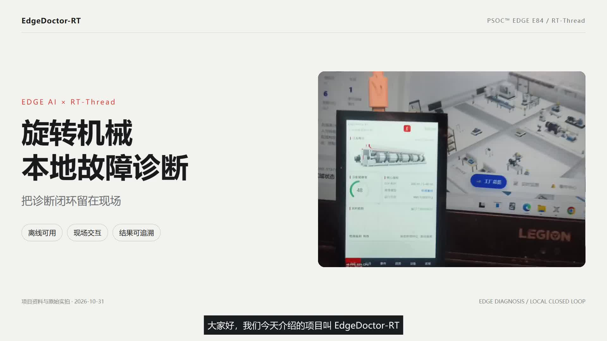
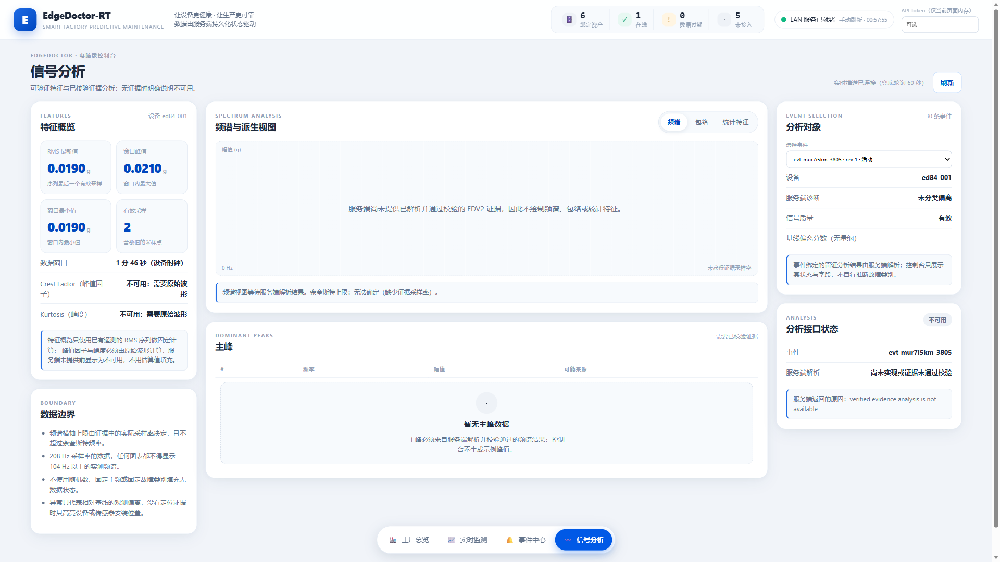
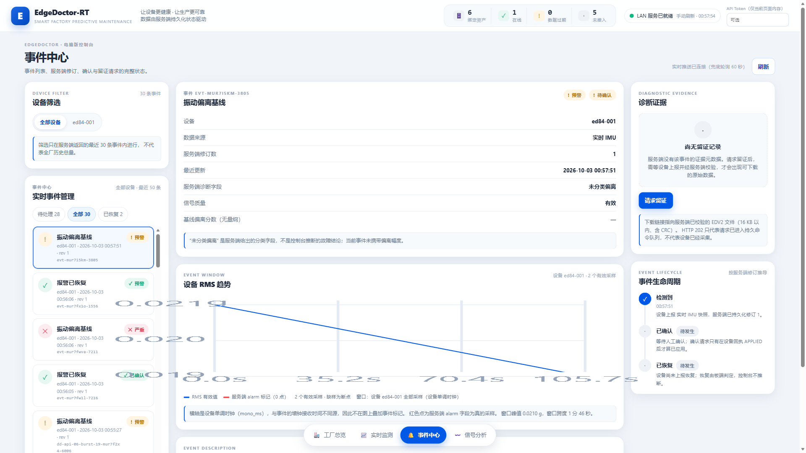

# EdgeDoctor-RT

**让旋转机械拥有自己的“边缘医生”——面向预测性维护的离线 Edge AI 智能诊断终端**

基于 **Infineon PSoC™ Edge E84（Arm Cortex-M55）+ RT-Thread**，把振动数据处理、频域特征提取、神经网络推理、屏幕交互与诊断留痕集成到 MCU 端。**断网也能诊断，现场就能看懂，结果可以追溯。**

> 2026 RT-Thread 嵌入式大赛参赛作品 · Edgi-Talk 赛道

[观看项目演示](https://devinhuang2001.github.io/EdgeDoctor-RT/) · [查看源代码说明](README_源代码说明.md) · [项目设计文档](docs/EdgeDoctor-RT_项目设计文档.pdf)



## 1. 为什么选择 EdgeDoctor-RT

电机、风机、泵与工业传动系统需要及时发现异常。EdgeDoctor-RT 将智能诊断部署到设备现场，让维护人员从“看到一串波形”走向“读懂设备状态”。

- **离线自主诊断**：数据处理与模型推理在 MCU 本地完成，核心诊断流程无需云端服务。
- **五类状态，一屏掌握**：识别正常、轴承内圈故障、轴承外圈故障、不对中与不平衡，同时呈现置信度、异常分和处置建议。
- **轻量模型，适配 MCU**：64 维频带特征搭配 64-32-5 MLP，静态 Q7 模型参数仅 **2,508 B**，在留出记录测试中取得 **96.50%** 准确率。
- **可视化更好用**：LVGL 本地 HMI 展示健康状态、频谱、诊断与系统信息；React + Three.js 桌面控制台提供设备监控、分析与事件查看。
- **实时任务协同**：20 ms 数据分块、滑动窗口分析、结果快照与异步日志相互配合，采集、推理和交互各司其职。
- **从诊断到留痕的完整流程**：串联数据工具、板端固件、MQTT 服务、桌面控制台与 CSV 日志，兼顾现场使用、演示和二次开发。

## 2. 核心指标

| 指标 | 结果 | 测试与配置 |
|---|---|---|
| 五类诊断准确率 | **96.50%** | KAIST v6 留出记录测试，200 个窗口、每类 40 个 |
| FP32 Macro-F1 | **96.44%** | 同一留出记录测试集 |
| 静态 Q7 Macro-F1 | **96.42%** | 同一留出记录测试集 |
| Q7 / FP32 预测一致率 | **99.50%** | 量化模型与浮点模型对比 |
| 模型参数体积 | **2,508 B** | 静态 Q7 权重与量化参数 |
| 数据处理节拍 | **20 ms** | 1 s 分析窗口，0.5 s 更新步长 |
| 数据规模 | **45 条记录 / 1,800 个窗口** | 按原始记录划分训练、验证与测试集 |

训练指标、混淆矩阵和量化结果可在 [模型评估数据](docs/verification/04_训练产物/metrics.json) 中查看。

## 3. 看得见的诊断体验

### 板端本地交互

800×480 LVGL 屏幕将健康状态、信号频谱、类别概率、处置建议与运行信息组织成清晰的页面。现场人员可以直接在设备端查看诊断结果，快速找到需要关注的信号。

### 桌面数字孪生控制台

Vite + React + TypeScript + Three.js 构建设备监控与分析界面，结合 FastAPI、MQTT 和 SQLite，把设备状态、趋势分析与事件记录连接起来。





### 诊断结果可追溯

板端结果经 RT-Thread 消息队列送入独立日志线程，异步写入 `/flash/edgedoctor.csv`。结果快照供 HMI 读取，日志写入与推理任务解耦，方便现场回看和问题分析。

## 4. 软硬件协同架构

```text
振动数据 / EdgePack 输入
          ↓
RT-Thread 实时任务 · 20 ms 数据分块
          ↓
1 s 滑动窗口 → 64 维频带特征 → 静态 Q7 五类推理
          ↓
类别 · 置信度 · 异常分 · 处置建议
          ├── LVGL 本地 HMI
          └── 异步 CSV 诊断日志

板载 IMU 监测 → MQTT → FastAPI / SQLite → 桌面数字孪生控制台
```

- **硬件平台**：RT-Thread Edgi-Talk / Infineon PSoC™ Edge E84 / Arm Cortex-M55。
- **实时系统**：基于官方 `Edgi_Talk_M55_XiaoZhi` v1.4.0 工程集成 EdgeDoctor 应用。
- **边缘算法**：归一化振动频带特征 + 轻量 MLP + 静态 Q7 参数。
- **工程设计**：固定内存、双缓冲快照、消息队列与独立日志线程，提升多任务协作效率。
- **数据工具链**：按记录划分数据后生成窗口；EdgePack 携带采样信息、标签与 CRC32，支持可复现的板端回放。

## 5. 仓库结构

```text
EdgeDoctor-RT/
├── firmware/                  RT-Thread 板端工程
│   └── applications/edgedoctor/
│       ├── dsp/               窗口构建与频域特征
│       ├── inference/         推理与模型参数
│       ├── logger/            异步日志
│       ├── profiler/          性能统计
│       ├── protocol/          MQTT 与 EDV2 数据封装
│       ├── runtime/           监测任务与健康基线
│       ├── sensor/            板载 IMU 监测
│       └── ui/                LVGL 本地交互
├── host/
│   ├── ai/                    训练、量化与导出
│   ├── server/                FastAPI / MQTT / SQLite 服务
│   ├── ui/desktop/            React + Three.js 桌面控制台
│   ├── tools/                 数据校验与 EdgePack 工具
│   ├── tests/                 C / Python / 浏览器验证
│   └── docs/                  技术与开发文档
├── docs/
│   ├── index.html             项目展示页
│   ├── images/                项目图片与控制台截图
│   ├── video/                 演示视频与字幕
│   ├── verification/          测试记录与训练产物
│   └── presentation/          答辩与演示材料
├── README_源代码说明.md         构建与移植指南
└── LICENSE                    Apache-2.0
```

## 6. 快速上手

### 固件构建与烧录

1. 安装 RT-Thread Studio 2.3.1，通过 SDK Manager 安装 `PSOC_E84-EDGI-TALK` BSP **v1.4.0**。
2. 将 `firmware/` 放到短路径、无中文的目录，例如 `D:\work\Edgi_Talk_M55_EdgeDoctor`。
3. 在固件目录执行 `mklinks.bat` 或 `mklinks.sh`，链接官方 SDK 的 `rt-thread`、`libraries` 和 `libs`。
4. 使用 Arm GNU 13.3 工具链，运行 `scons -j4`。
5. 通过 KitProg3 / CMSIS-DAP 的 `DAP / Program-Debug` 接口烧录。

### 板端体验

```console
msh /> edgeai info
msh /> edgeai replay /flash/synthetic_smoke_2s.edgp
msh /> edgeai replay /flash/synthetic_smoke_2s.edgp fast
```

### 主机工具与桌面端

```powershell
# 主机回归
cd host
.\scripts\test.ps1

# 桌面端
cd ui\desktop
npm ci
npm run build
npm test
```

更多服务端配置、数据准备与移植步骤见 [源代码说明](README_源代码说明.md)。

## 7. 数据集与开源许可

训练与评估使用 KAIST Human Lab 旋转机械数据集 v6（[Mendeley Data](https://data.mendeley.com/datasets/ztmf3m7h5x/6)，DOI 10.17632/ztmf3m7h5x.6，CC BY 4.0）。原始数据可从数据集页面下载，数据处理流程见 [数据管线说明](host/docs/data-pipeline.md)。

本仓库代码采用 **Apache License 2.0**，详见 [LICENSE](LICENSE)。

**让设备状态看得见，让智能诊断走到现场。**
