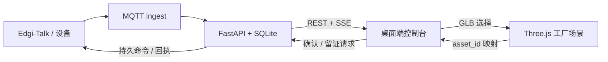

# EdgeDoctor-RT 电脑版数字孪生控制台规格

版本 0.1，2026-09-14。状态：待实施。本文定义桌面端控制台的目标实现，不能作为已经完成、已接入设备或已验证诊断能力的证明。

## 1. 目标、范围与原则

目标是在不改变板端采集、诊断、MQTT 和服务端事件权威性的前提下，替换当前 `/dashboard/` 的单页设备诊断台，提供可操作的工厂总览、单设备实时监测、事件闭环和留证查看入口。

首版覆盖以下范围：

- 桌面优先页面：工厂总览、实时监测、事件中心、信号分析。
- 以 `EdgeDoctor_SmartFactory_Web.glb` 展示六区工厂，以 `assets/induction_motor.glb` 展示电机详情。
- 选择模型设备后联动既有状态、趋势、事件、确认和留证接口。
- 保留当前服务的鉴权、事件版本和设备命令回执语义。
- 在数据不存在、过期、模型未绑定或证据未解析时，明确说明状态而不展示演示值。

首版不包括多租户、用户体系、移动端原生应用、持续原始波形上传、工艺控制、自动停机、预测性剩余寿命或故障部件级定位。`LIVE_IMU` 的异常仍只代表相对基线的观测偏离；没有经验证的定位证据时，只高亮设备或 IMU 安装位置。

现有 `server/web/` 及其 `/dashboard/` 在新版验收前保持可运行。新版先以 `/dashboard-v2/` 部署，切换默认入口另行评审。

## 2. 设计依据与素材边界

| 来源 | 可采用内容 | 不可直接采用的内容 |
|---|---|---|
| Stitch 页面包 | 四页的浅色工业风、信息层级和页面布局 | 整页嵌图、固定设备数与状态、在线 CDN、随机频谱和样例故障结论 |
| SmartFactory 3D 包 | 六区模型、资产根节点、设备/部件语义、预览图 | `demo_not_connected` 状态、拟定 MQTT topic、无数据依据的部件故障高亮 |
| 当前服务 | 状态、趋势、事件、SSE、确认、留证和维修记录接口 | 将单设备列表长度解释为全厂统计，或将 HTTP 202 当成设备已执行 |

模型包采用 CC0 几何资产和 MIT 源脚本许可；集成时将许可证文本随打包资产保留。模型使用通用示意尺寸，不作为工程 CAD 或维修指引。

## 3. 总体架构

新前端源代码位于 `ui/desktop/`，使用 Vite、TypeScript、React 和 Three.js 构建；构建产物写入 `server/web-v2/`，仍由同一个 FastAPI 进程托管。前端不直接连接 MQTT 或 SQLite，所有业务数据均经过 HTTPS/HTTP API 和现有 SSE 流。



前端分为五层：路由与页面壳、API 客户端、运行时状态仓、通用可视化组件、3D 场景。API 客户端只返回经过 schema 校验的数据；页面不得自行推断报警、设备在线或诊断结论。3D 场景只持有渲染和选择状态，业务实体由 `AssetBinding` 配置映射。

## 4. URL、页面与交互

| 路由 | 页面 | 主要内容 | 关键操作 |
|---|---|---|---|
| `#/factory` | 工厂总览 | 六区列表、工厂模型、设备摘要、选中设备状态 | 选择分区/设备、聚焦相机、进入实时监测 |
| `#/monitor/:deviceId` | 实时监测 | 设备模型、最新状态、RMS/异常分数、趋势、最近事件 | 选择时间范围、进入事件、刷新 |
| `#/events` | 事件中心 | 设备筛选、事件列表、版本详情、趋势、证据状态 | 确认、请求留证、查看/下载已验证证据 |
| `#/analysis/:deviceId` | 信号分析 | 已存在的真实特征、留证分析结果或未可用状态 | 选择证据和分析视图 |

全局顶部显示服务就绪状态、当前数据源与最后刷新时间；底部导航在桌面宽度下固定在可视区域内，但不得遮挡图表和操作按钮。首版以 1440 px 及以上为主布局，1280 px 至 1439 px 收紧侧栏，低于 1024 px 显示“请使用桌面浏览器”的简化视图，不把桌面三栏强行压缩为手机布局。

每个页面必须覆盖：加载中、无数据、服务不可用、认证拒绝、数据过期、已恢复但未确认、活动报警、命令待回执和命令拒绝状态。颜色是辅助信息；文字、图标和 ARIA 标签必须表达同一状态。

## 5. 数据与命令合同

### 5.1 复用接口

| 用途 | 接口 | 页面规则 |
|---|---|---|
| 服务就绪 | `GET /health/ready` | 失败只标记服务不可用，不清空已渲染历史数据，并标明数据时间 |
| 最新设备状态 | `GET /api/v1/query/status?device_id=` | 显示状态、最新遥测、事件与建议；`NO_DATA` 不展示健康结论 |
| 原始趋势 | `GET /api/v1/trends?device_id=&limit=` | 仅绘制有数值的 `rms_vector_g`；缺样以断点呈现 |
| 事件及版本 | `GET /api/v1/events`、`GET /api/v1/events/{event_id}` | 列表按服务端顺序显示，详情展示 revision，不在客户端合成新版本 |
| 实时刷新 | `GET /api/v1/stream` | 收到消息后 250 ms 去抖刷新；断开后回退到 10 秒轮询 |
| 确认事件 | `POST /api/v1/events/{event_id}/ack` | 202 只显示“确认请求已提交”；轮询命令结果后才显示已应用、拒绝或过期 |
| 请求留证 | `POST /api/v1/events/{event_id}/evidence-request` | 202 只显示“留证请求已提交”；证据元数据存在且 CRC 合格才可下载 |
| 证据 | `GET /api/v1/events/{event_id}/evidence`、下载接口 | 未存在、CRC 不通过或认证失败均不得显示“原始数据可用” |
| 维修记录 | 既有 `/api/v1/assets/{asset_id}/maintenance*` | 仅在资产绑定到可用 `asset_id` 后展示 |

新增 API 应最小化为三个只读端点：

- `GET /api/v1/factory/summary`：返回绑定资产总数、按运行状态计数、每项的 `asset_id`/`device_id`/最后遥测接收时间；服务器以实际持久化时间计算在线状态。
- `GET /api/v1/assets/{asset_id}/binding`：返回资产名称、区域、模型实例、关联设备和传感器位置，不返回 MQTT 凭据或内部 topic。
- `GET /api/v1/events/{event_id}/analysis`：仅在 EDV2 已被服务端解析和校验后返回采样率、单位、时间轴、波形/频谱派生数据及版本；未实现时返回 404 或 `available:false`。

在线状态定义必须由服务端发布，并使用冻结阈值。建议默认值：最新有效遥测接收时间不超过 30 秒为 `ONLINE`，超过 30 秒为 `STALE`，没有可用绑定或从未收到遥测为 `UNKNOWN`。不能从当前事件数、网页连接或 MQTT PUBACK 推断在线。

### 5.2 资产绑定配置

新增版本化配置 `ui/desktop/src/config/asset-bindings.json`，由构建过程校验并同时生成服务端可读取的副本。每条绑定至少包含：

```json
{
  "schema_version": 1,
  "asset_id": "motor-01",
  "device_id": "ed84-001",
  "scene_instance": "MOTOR_01",
  "zone": "B",
  "detail_model": "models/induction_motor.glb",
  "sensor_node": "IMU_Sensor",
  "display_name_zh": "旋转实验区电机 01",
  "binding_state": "verified"
}
```

`binding_state` 只允许 `verified`、`provisional` 和 `unbound`。`provisional` 必须在界面可见标识，`unbound` 的模型可浏览但不显示为在线设备。模型包示例的 `motor01`、topic 和 `demo_not_connected` 均不可直接写入生产绑定。

## 6. 3D 场景规范

总览按需加载 `EdgeDoctor_SmartFactory_Web.glb`；详情页进入后再加载电机细节 GLB，不在初始页面同时下载。加载过程显示百分比与静态预览降级按钮。加载/渲染失败不得影响事件和设备数据页面。

场景使用受限 OrbitControls：允许旋转、缩放、复位与分区聚焦；禁止自由平移到远离工厂的空白位置。点击射线检测命中后，向上查找带 `asset_id` 或绑定 `scene_instance` 的根节点。选中设备显示描边和侧栏；活动报警用颜色与状态标识高亮整个绑定设备或 `sensor_node`。恢复或未确认状态按其真实组合显示，不改变诊断结论。

3D 质量门槛：首屏场景资源下载完成后才允许操作；渲染循环在页面不可见时暂停；销毁页面时释放 renderer、几何、材质和事件监听；连续进入/离开总览 20 次不得有持续增长的 WebGL 资源计数。首版不承诺特定 GPU 上的帧率，需以验收设备实测为准。

## 7. 信号分析与证据规则

实时监测页首版只使用已存在的 RMS、异常分数及趋势。信号分析页可以展示固定计算的真实特征，但频谱、主频、峰值、三轴波形必须来自已校验的 EDV2 证据或明确标为不可用。

频谱横轴上限由证据中的实际采样率决定，最大不超过奈奎斯特频率。对于 208 Hz 数据，图表不得显示 104 Hz 以上的“实测频谱”。不得使用 `Math.random()`、固定 42.3 Hz 峰值或“轴承异常”等样例内容填充无数据状态。

## 8. 安全、可靠性与可访问性

- 所有写操作继续由 `X-Edgedoctor-Token` 保护；令牌不得写入构建产物、URL、日志或浏览器持久化存储。
- 渲染文本一律使用 DOM 文本节点或经过转义的受控模板；事件 ID、维修备注和服务端字符串不能直接写入 `innerHTML`。
- API 失败、401、429、5xx、超时和格式校验失败都显示可恢复错误。请求取消和路由切换不得把旧设备响应覆盖新设备页面。
- 关键按钮可通过键盘操作，焦点可见；图表和模型给出名称/当前选择的文字替代；状态颜色至少满足 WCAG AA 对比度。
- 前端运行不得写入数据库，不得直接订阅 MQTT，不得改变板端采集和报警线程。

## 9. 文件布局、实施顺序与交付

```text
ui/desktop/
  src/{pages,components,api,state,scene,config,styles}/
  public/models/{factory-web.glb,induction_motor.glb}
  package.json vite.config.ts
server/web-v2/                 # 仅构建产物，随部署生成
server/app.py                  # 增加新版静态挂载和必要只读 API
tests/server/test_dashboard_api.py
tests/ui/                      # 浏览器与视觉回归测试
```

实施顺序：先冻结资产绑定并建立 `/dashboard-v2/` 壳；再迁移现有状态、趋势和事件闭环；随后接入 3D 总览与设备详情；然后增加服务端汇总和证据分析接口；最后完成性能、可访问性、断网和浏览器验收。每个功能改动后执行前端构建、受影响的 Python 回归和完整 `scripts/test.ps1`；服务端改动后保持现有 `scripts/build-firmware.ps1` 基线可构建，且不修改启动、链接、HAL、生成配置或 Wi-Fi 资源。

交付物包括：源代码、锁定依赖、构建说明、资产许可证、绑定配置、测试脚本、截图/性能记录与本规格对应的验收结果。未具备真实设备、原始证据、GPU 或网络条件的项目必须标为 `MISSING_EVIDENCE`，不能以原型截图代替通过。

